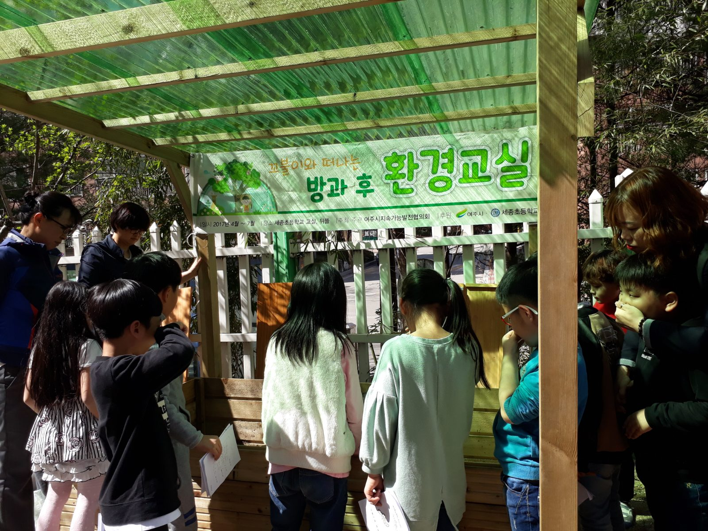
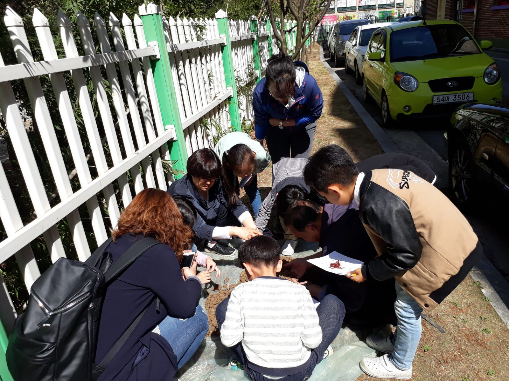
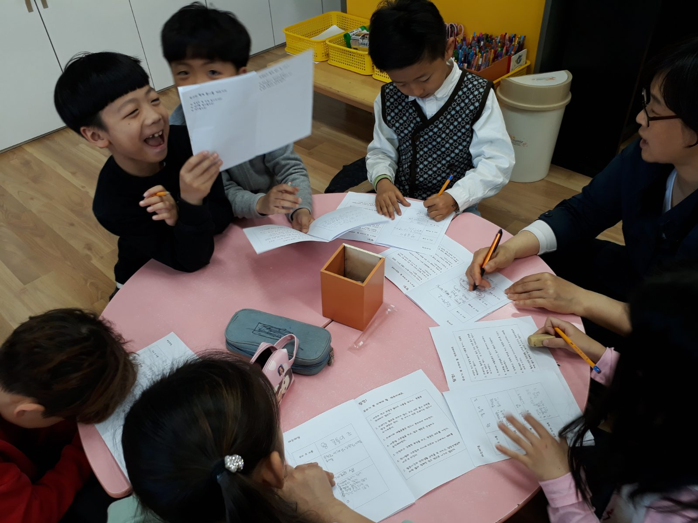
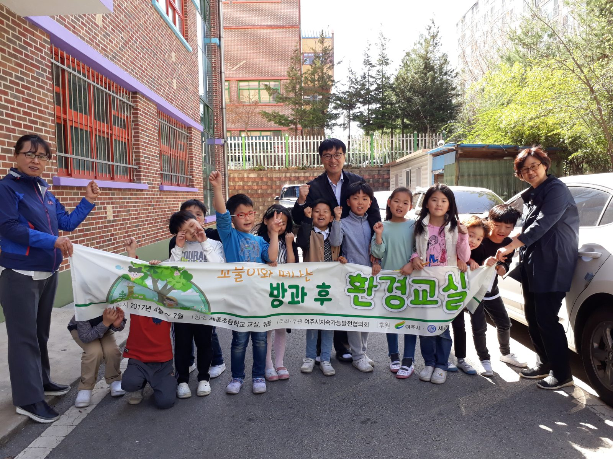

여주시지속가능발전협의회(상임회장 한득현) 도시생태분과가 세종초등학교에서 방과후 학생들을 대상으로, 학교에서 나오는 음식물쓰레기와 지렁이를 활용한 '어린이 환경교육'을 실시하고 있습니다.

7월 10일 '꼬불이와 떠나는 환경교육'이라는 주제로 첫 수업을 실시했는데요. 아이들이 낯선 지렁이를 보면서 신기해하기도 하면서 참 즐거워 했습니다.

앞으로 7월달 까지 ▲지렁이 사육 화분 만들기 ▲학교 숲 환경교육 ▲지렁이 삼행시 짓기와 그림그리기 ▲나만의 화분 만들기 ▲지렁이가 먹는 음식물의 양 알아보기 ▲음식물 염도에 따른 지렁이의 반응 알아보기 ▲지렁이 화분 분양 등 체험 위주의 교육을 계속 실시할 계획입니다.

이번 교육을 통해 자라나는 아이들이 음식의 소중함과 환경의 중요성을 잘 알게 됐으면 좋겠습니다.

