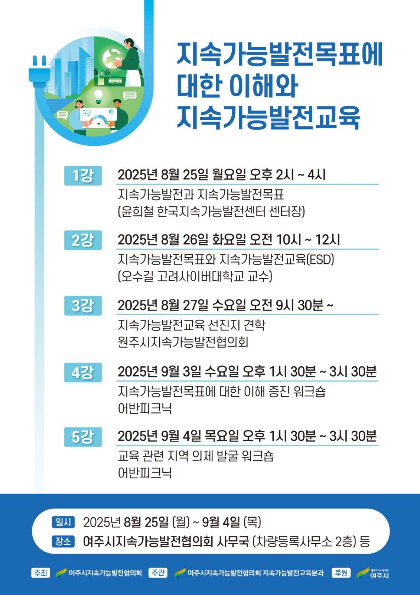
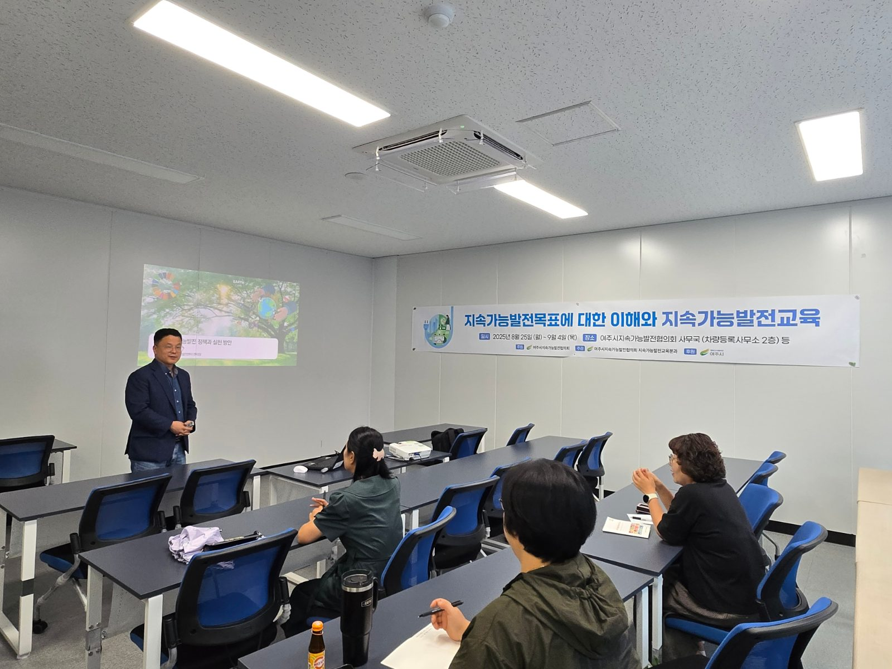
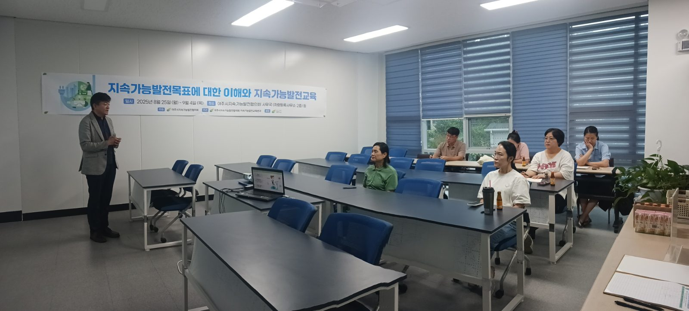
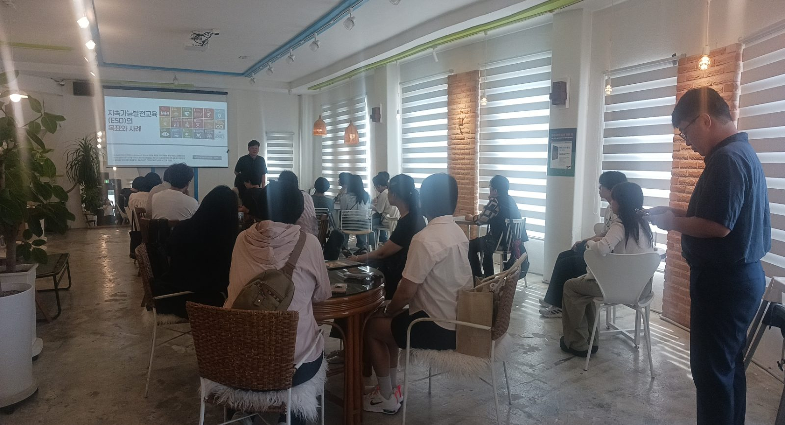
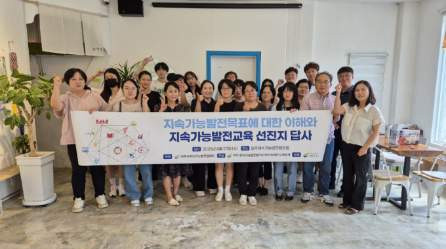
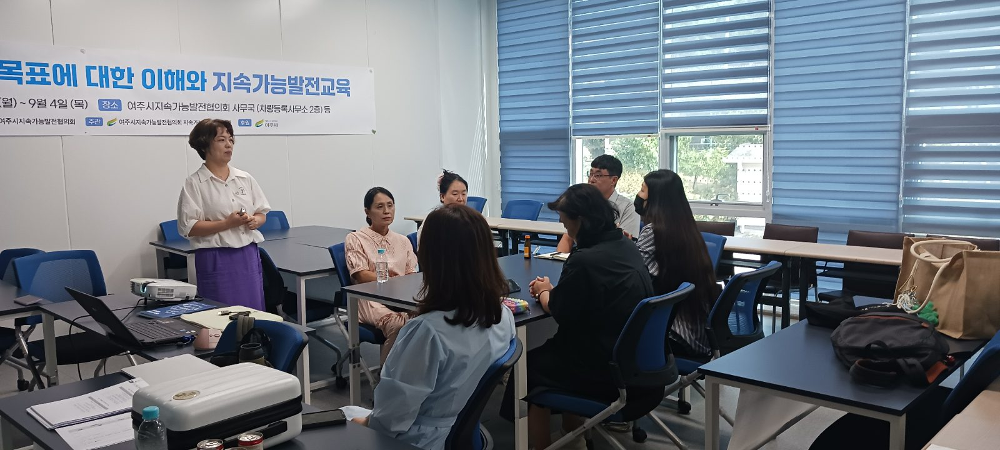
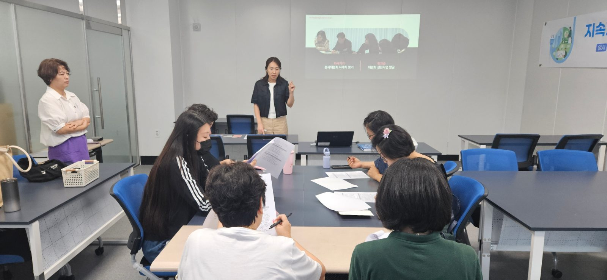

2025년 8월~9월 총 5강

대상: 분과원 10여명

여주시지속협 교육분과 위원들을 대상으로 한 지속가능발전 목표에 대한 이해와 지속가능발전교육

여주시지속가능발전목표에 대한 이해를 높이고 지역에서 확산할 수 있는 계기를 마련

 

1강)지속가능발전 과 지속가능발전목표

2강)지속가능발전 목표와 지속가능발전 교육

3강)지속가능발전교육 선진지 견학

4강)지속가능 목표에 대한 이해증진 워크숍

5강) 교육관련 지역의제발굴 워크숍

