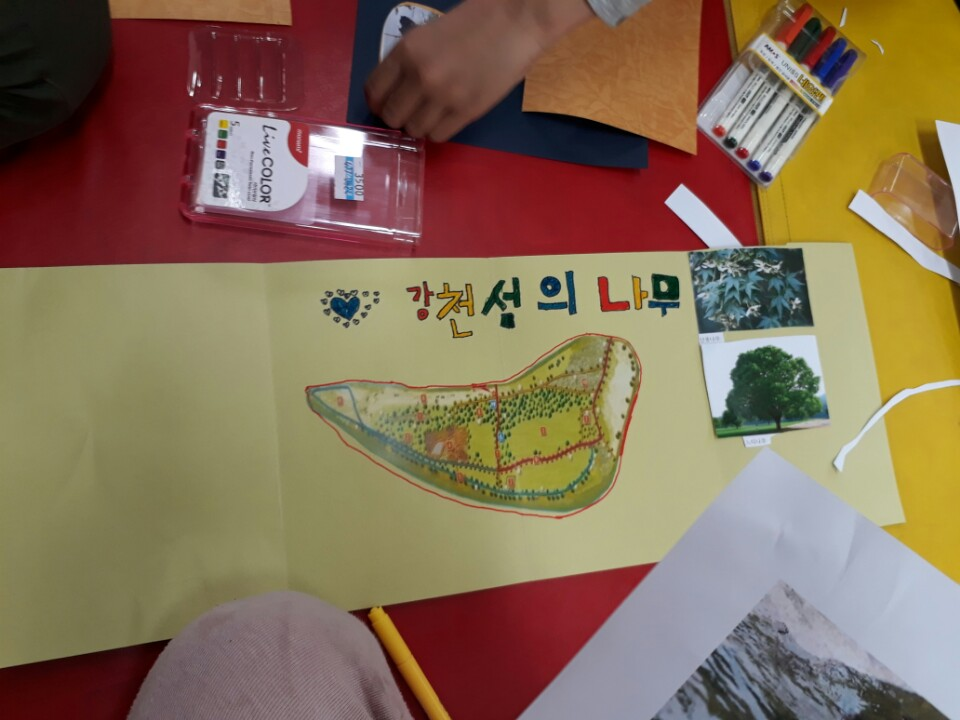
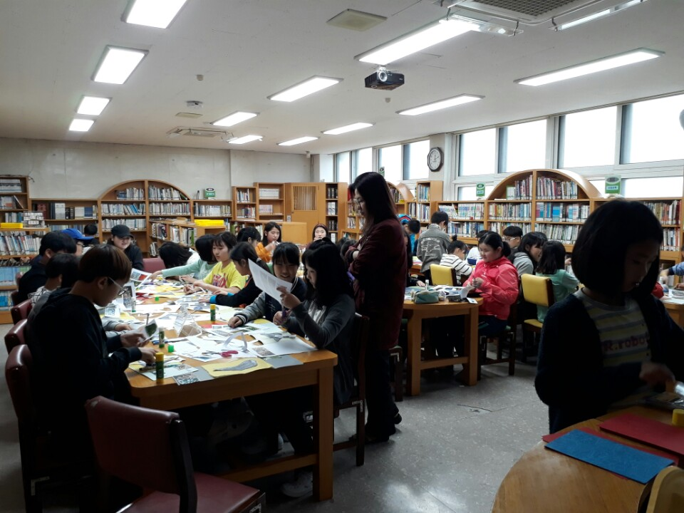
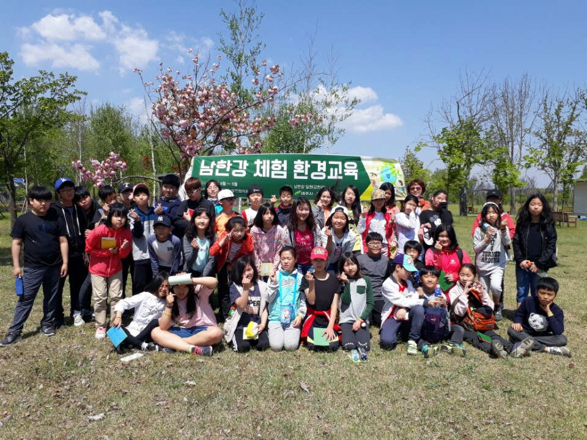

경기 여주시 지속가능발전협의회 4월 27일 강천초등학교 5~6학년 학생 41명과 5월 10일 금당초등학교 1~3학년과 함께 강천섬 등지에서 ‘남한강 체험환경교육’을 실시했다.

이번 남한강 체험환경교육은 미래의 주역인 여주지역 초등학생들에게 남한강의 우수한 생태문화자원을 홍보해 자연환경 보존의 중요성을 이해하게 함으로써 여주시의 장기적 지속가능발전을 도모하는 여주시지속협의 계속사업 중 하나다.

학생들은  강천섬과 인근 야산 등지에서 멸종위기 2급 식물인 ‘단양쑥부쟁이’ 등 토종 식생을 관찰하고 만져보는 등 현장체험을 실시했다.

이들은 현장교육에 앞서 4월 17일 강천초등학교와 5월 8일 금당초등학교 교실에서 약 두 시간여에 걸쳐 남한강을 따라 분포하는 여주시의 식생에 대한 이론교육을 실시하였다.

학생들은 이론교육에서 교재를 통해 배운 식물들을 직접 찾아보고, 식물의 특성을 확인해 보는 등의 현장 교육을 통해 자연의 중요성을 몸소 체험했다.

