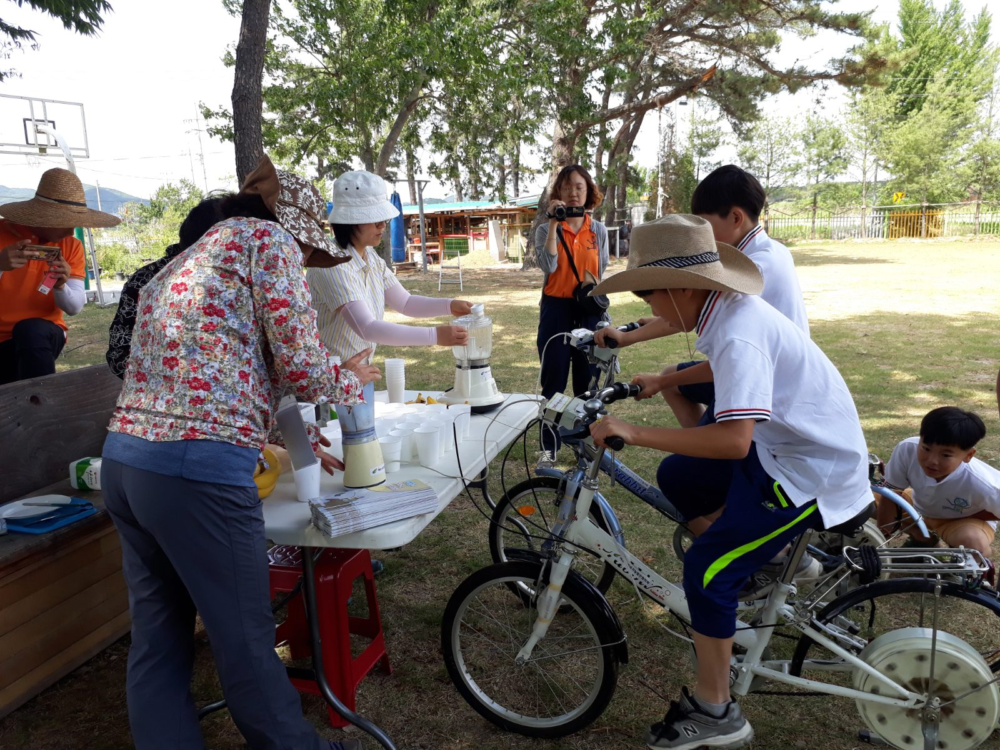
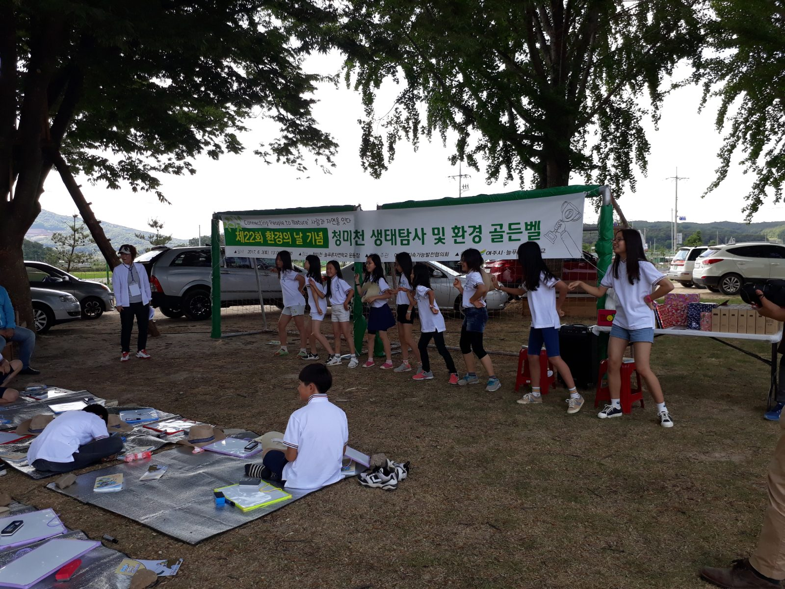
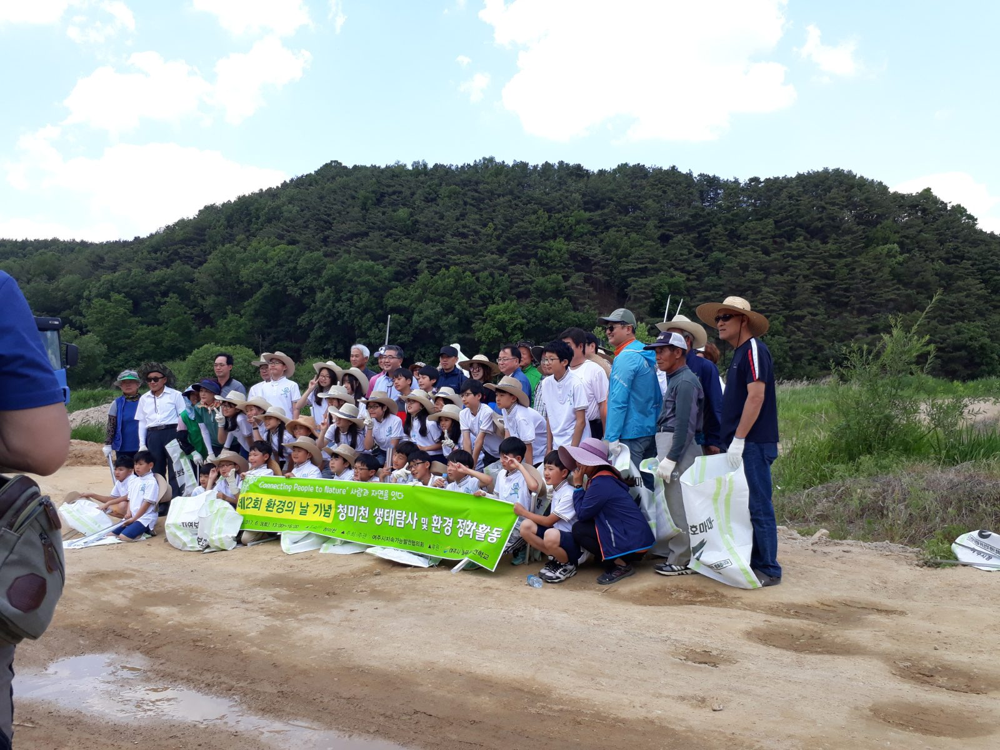
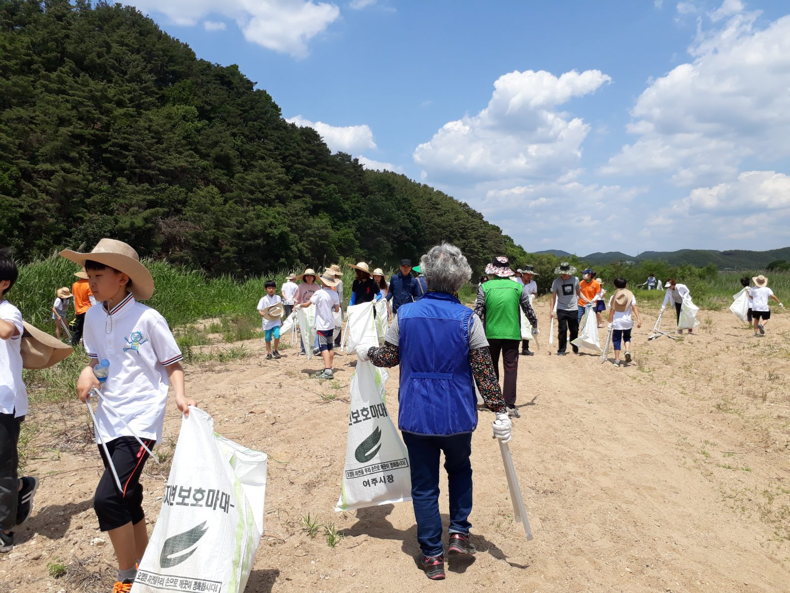
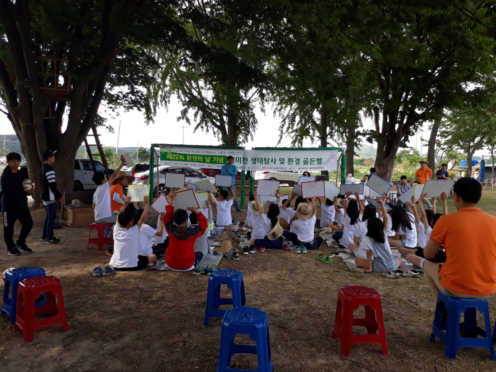

여주시지속가능발전협의회(상임회장·한득현)가 지난 3일 점동면 청미천 주변과 늘푸른자연학교에서 '사람과 자연을 잇다'란 주제로 제22회 환경의 날 기념행사를 진행하였습니다~  
 

이날 행사는 청미천 환경정화 활동과 청미천 식생교육, 자전거 발전기로 바나나 음료 만들어 먹기, 환경 골든벨 등의 프로그램 순으로 진행되었고  
 
맨 처음 실행된 청미천 환경정화 활동에는 원경희 여주시장, 김용해 점동면장, 점동면 주민, 여주시지속협 관계와 늘푸른자연학교 학생 등 80여명이 참여했으며 환경정화 활동 이후에는 늘푸른자연학교 학생들을 대상으로 청미천변 식생교육과 환경골든벨을 진행하였습니다~

