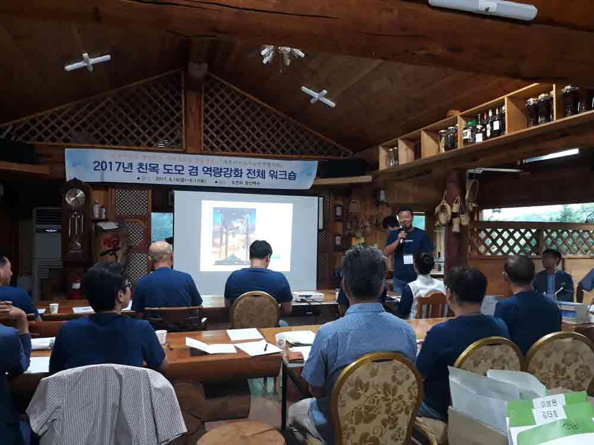
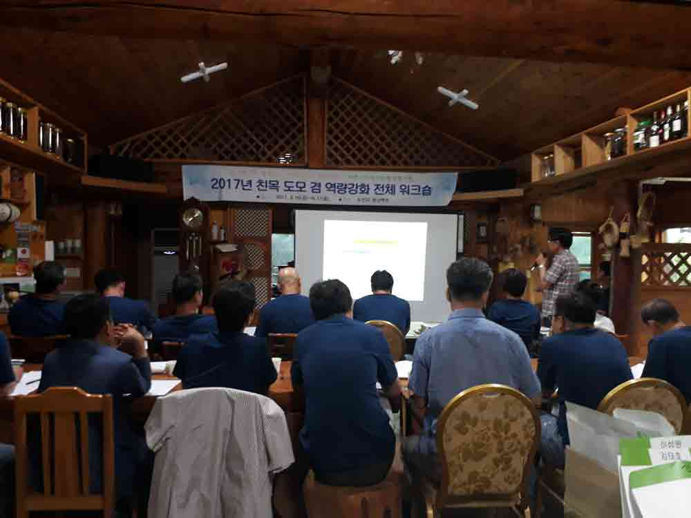
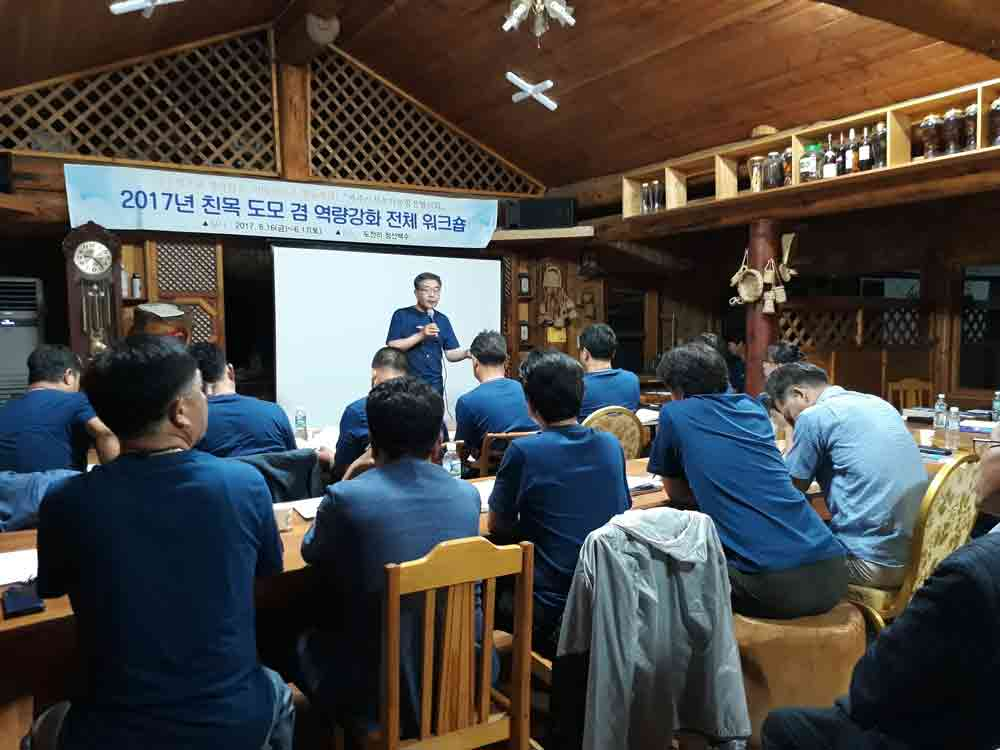
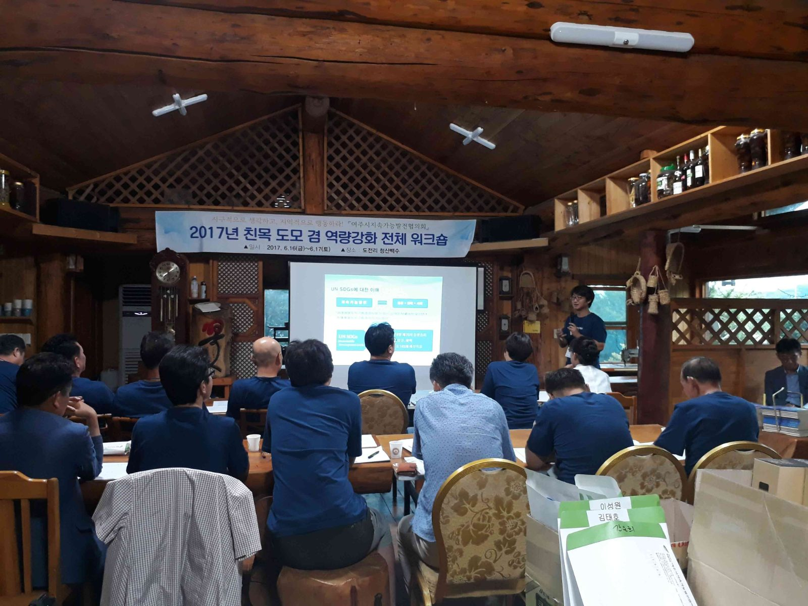

《여주시지속협 친목도모 겸 역량강화 전체 워크숍 개최》

≫일시: 6월 16일(금) 오후6시~17일(토) 오전 10시까지

≫장소: 강천면 도전리 청산백수

≫프로그램: 지속협의 역사, SDGs(지속가능발전목표)란?, 분과 사례 발표, 교류의 시간 등...

    유익하고 좋은 시간 되었습니다~ 참석해주신 회원님들 감사드리고 일정때문에 못뵈었던분들은 다음번엔 꼭 뵈었으면 좋겠습니다^^

