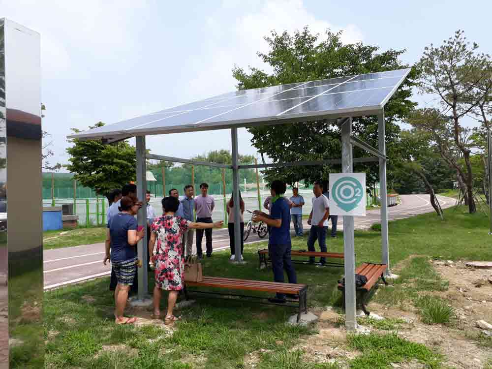
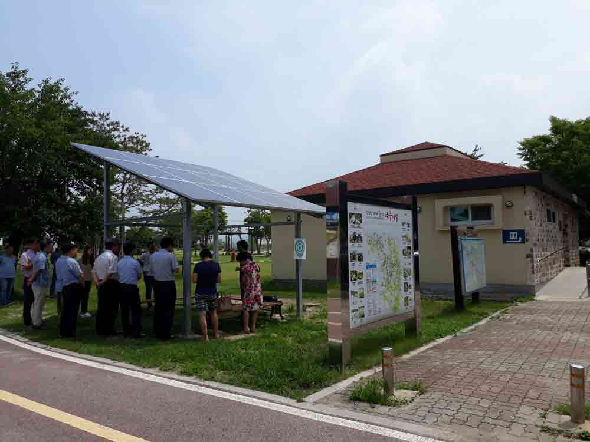
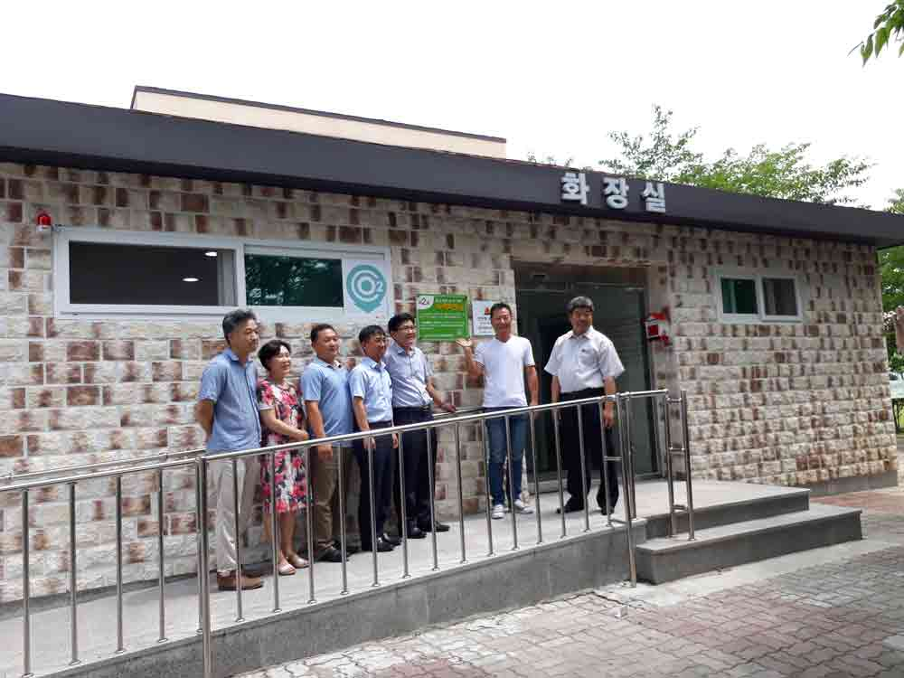
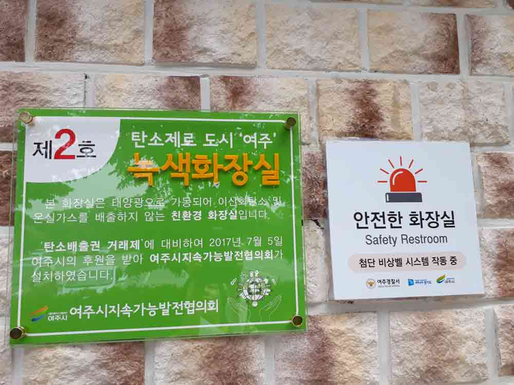

여주시지속가능발전협의회는 작년에 이어 올해도 태양광 발전기를 활용한 친환경 화장실 ‘제2호 여주시 탄소제로 녹색화장실’을 설치하였습니다~ 
 
올해는 사업을 확대해 총 4곳의 탄소제로 녹색화장실을 만들것이며 그 첫 번 째로 여주시 연양동 금은모래캠핑장 앞 공중화장실에 3Kw/h 태양광 발전설비를 설치, 7월 5일(어제) 현판식을 갖고 ‘제2호 여주시 탄소제로 녹색화장실’을 본격 가동하였습니다. 
 
특히, 제2호 여주시 탄소제로 녹색화장실은 주변 환경과의 조화를 고려해, 화장실 지붕에 집열판을 설치하지 않고 화장실 옆 공터에 집열판으로 지붕을 만들고 그 아래 벤치를 설치해 관광객들을 위한 그늘 쉼터로도 활용하였습니다~ 
 
이로써 영월루 근린공원 공중화장실에 이어 금은모래캠핑장 앞 공중화장실도 낮에 발전한 전력으로 밤에 불을 밝히는 등 필요 전력을 자체 생산해서 사용하게 됩니다~ 
 
또한 사용하고 남은 전기는 계속 누적되는 방식이어서 사용량보다 발전량이 많은 봄, 여름, 가을에 전기를 최대한 축적해, 24시간 온열기기를 가동 등으로 전력 소비량이 많은 겨울에도 전기세가 거의 발생하지 않습니다. 
 
여주시지속협은 향후 태양광 발전설비 설치 전과 후의 전기요금을 비교해 탄소제로 녹색화장실의 효율성에 대해 분석하고 이 같은 친환경 공중화장실을 연차적으로 확대해 나갈 방침입니다. 
 
여주시지속협은 향후 직면할 탄소거래제에 대비하고, 세종인문도시 명품여주의 친환경적이고 지속가능한 발전을 위해 탄소 저감 사업을 적극 발굴·시행할 것 입니다. 
 
이 사업은 ‘공공시설 탄소저감 프로젝트’ 사업으로 2014년 제6회 경기지속가능발전대회에서 대상을 수상한 바 있음.

<ul>
<li>

</li>
</ul>
