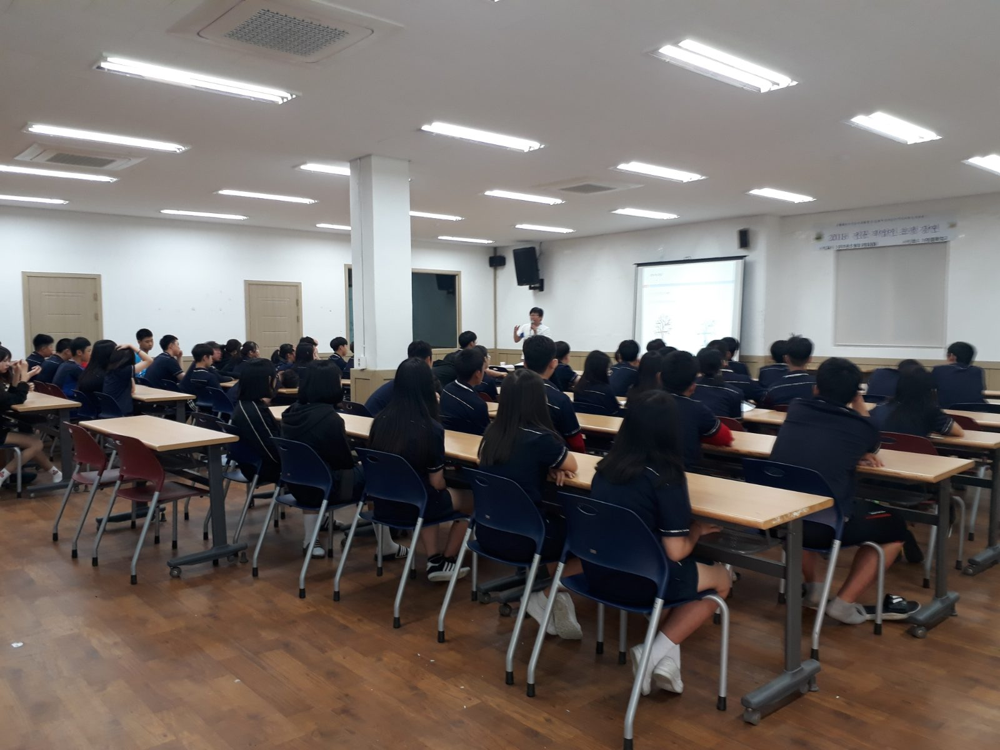
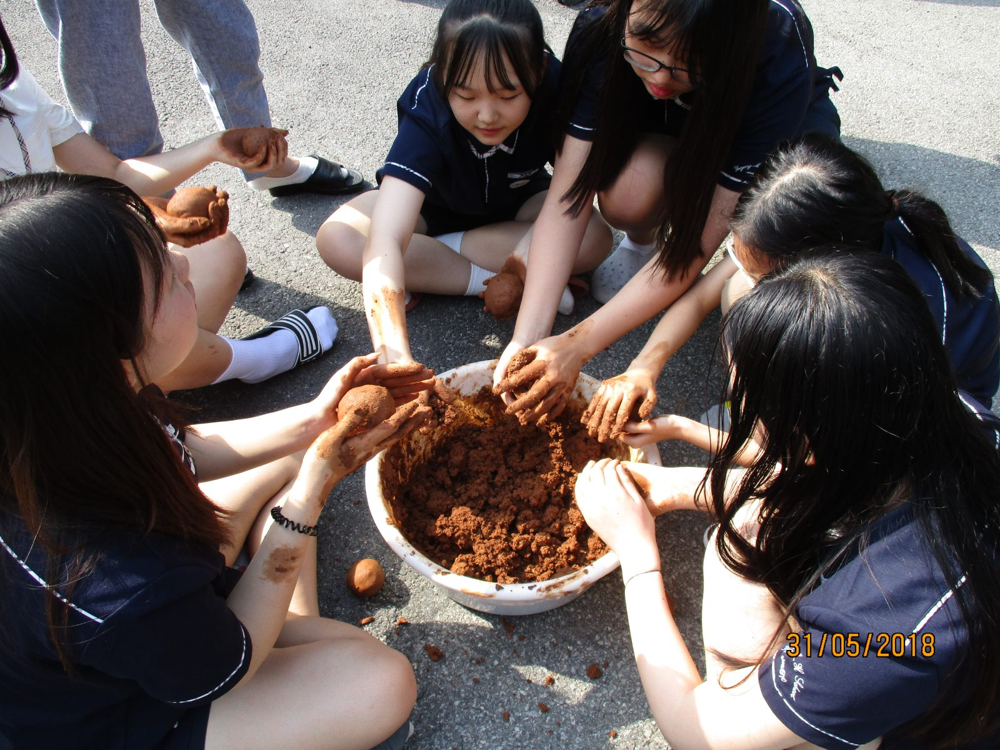
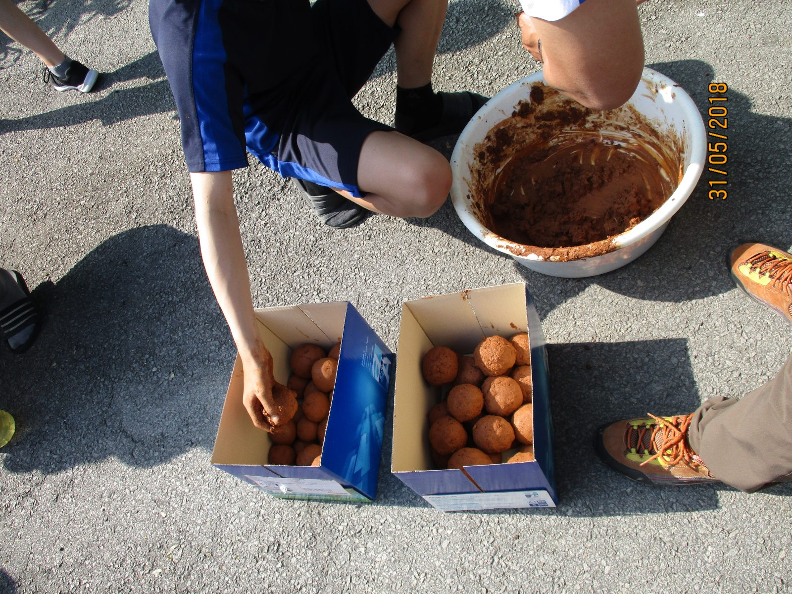
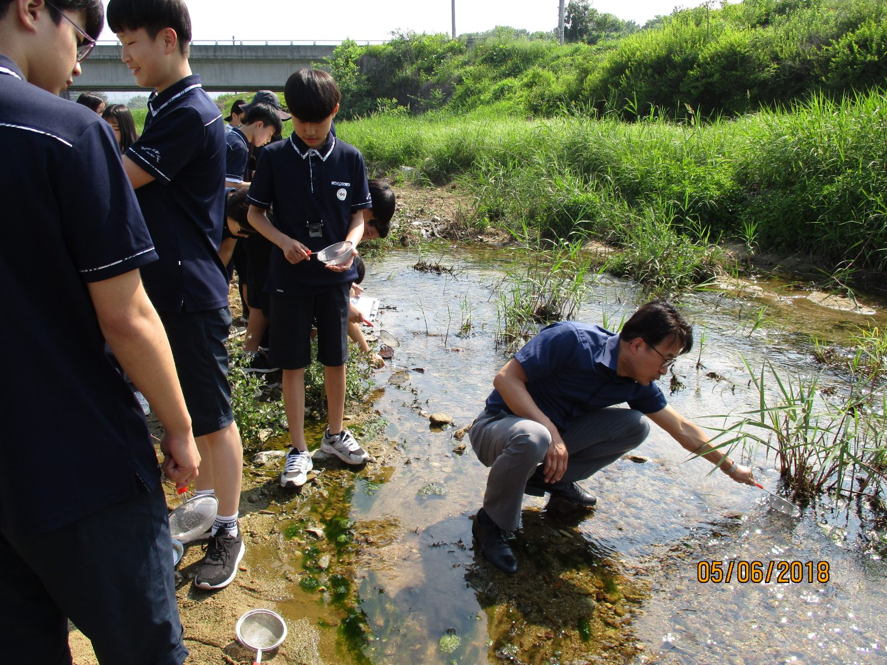
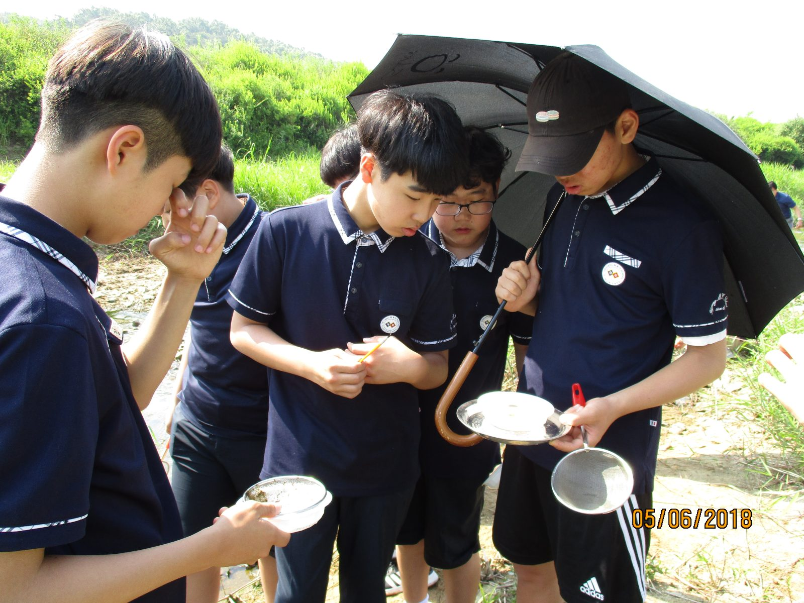
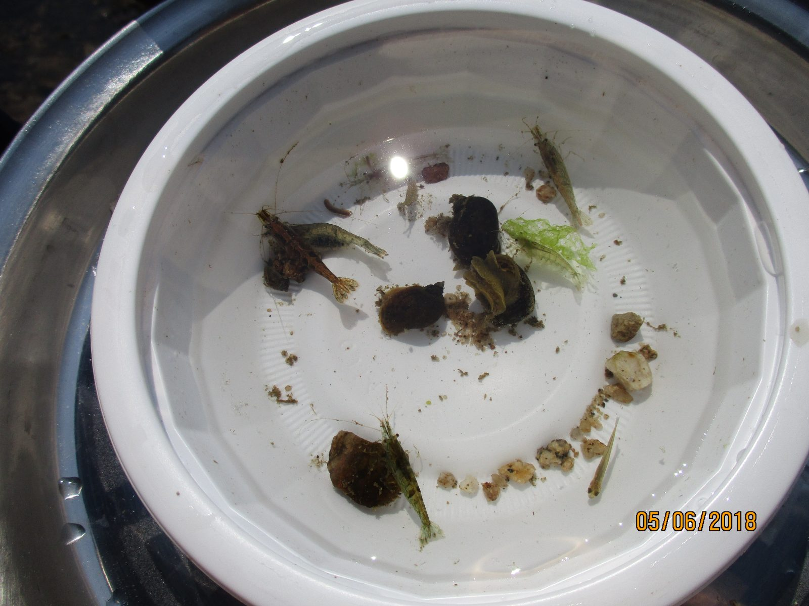
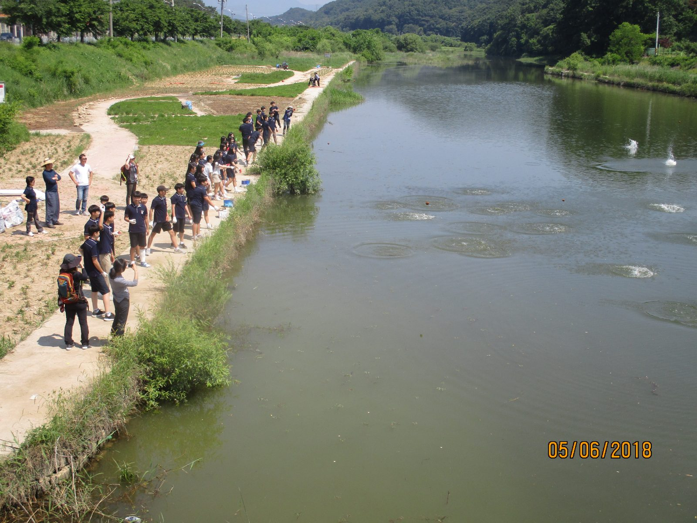
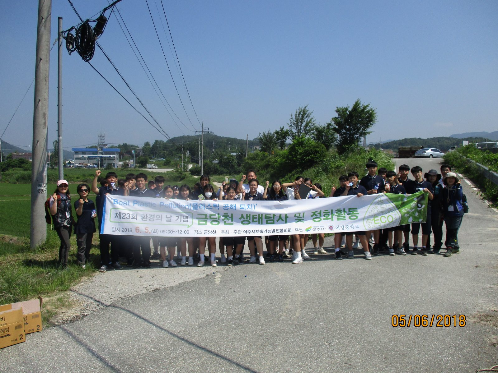
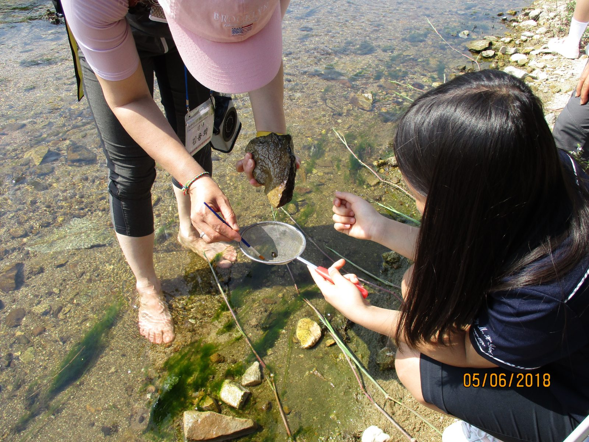

환경의 날 기념행사를 잘 마무리 하였습니다.~

<ul>
<li></li>
</ul>

- 행 사 명: 제23회 환경의 날 기념, ‘청소년 금당천 생태탐사 및 정화활동’ 
- 행사기간: 2018 6월 5일(화) 09:00~12:00 
(사전행사: 5월 31일(목), 하천 이론교육 및 EM 흙공 만들기) 
- 행사장소: 여강중학교, 금당천 일원 
- 참여대상: 여강중학교 학생 외 80명 내외 
- 주 관: 여주시지속가능발전협의회 
- 후 원: 여주시, 여강중학교  * 하천에서는 물당팽이,민물새우,송사리,날도래,하루살이유충, 실잠자리유충 등등이 관찰 되었습니다~~^^

 
더운 날씨에 참석해주신 모든 분들 감사드립니다~^^
 

