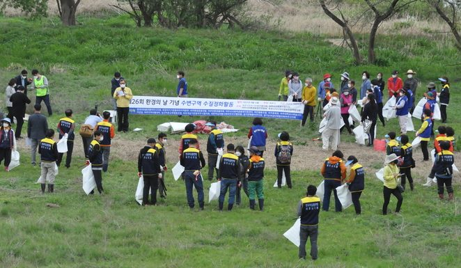
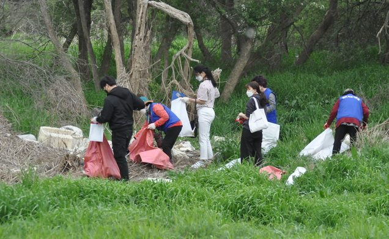
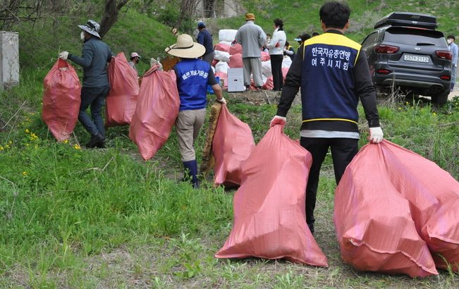
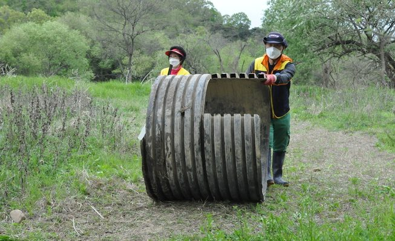
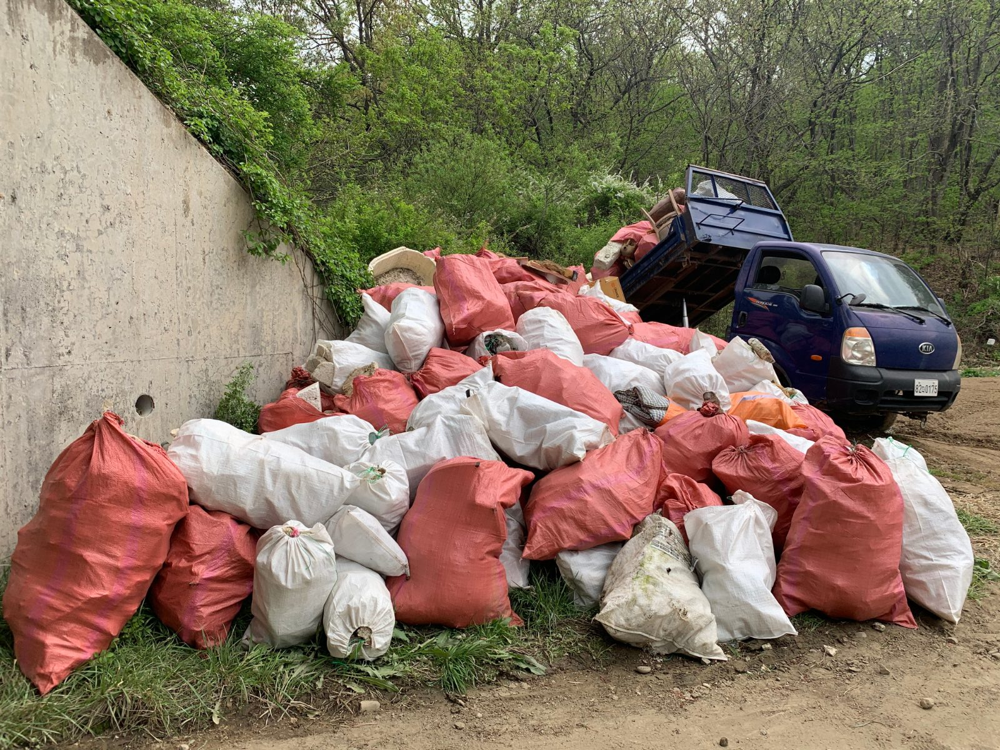

2021년 4월23일 ---&gt;흥천면 부처울 습지 환경정화 
 
*코로나 방역지침에 의거하여 야외에서 거리두기 및 강을 경계로 계신리 습지 90명, 상백리 습지 60명씩 진행 
 
*2020년 장마 및 홍수로 인한 부처울 습지 부유 쓰레기 청소 약300마대 이상 
 
주최/주관: 여주시지속가능발전협의회, 여주시사회복지협의회, 특별대책지역 수질보전정책협의회, 여주시친환경농업인연합회/ 여주시착한이웃 
 
참여단체: 한국자유총연맹, 한강지키기운동, 환경운동연합, 친환경출하회, 자활센터, 사회적공동체지원센터, 문화원, 여주대 사회봉사단, 여민협동조합, 여강길, 바르게살기운동, 대한적십자봉사회, 경기민예총, 여성단체협의회, 농산어촌교육협동조합 (여주시의 시민단체) 
 
*여주시의 깨끗한 환경을 위해 시간을 할애하여 정화활동에 힘써주신 모든분께 감사드립니다.~

