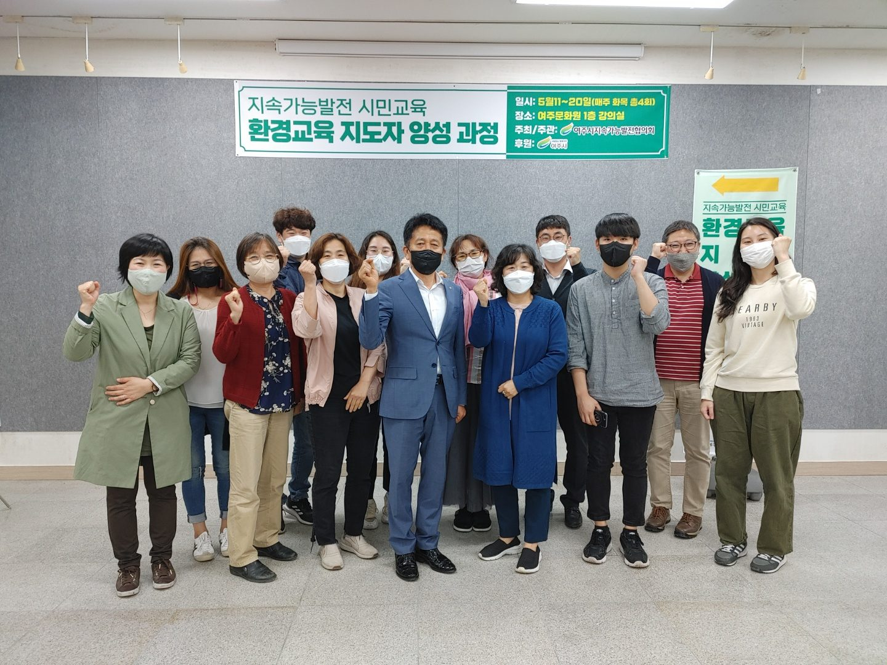

&lt;환경교육 지도자 양성 과정 진행&gt; 
 
*교육명: 여주형 지속가능발전&amp;환경교구 개발자 과정 
"지구를 구하는 플레이어들" 
*일시: 5월 11일~20일 (총4회 16시간) 
 
*환경교육 현장에 필요한 교구를 직접 개발하여 학습자 중심의 참여수업을 기획하고 운영할 수 있는 역량강화 교육 실시 
 
*코로나19 방역수칙 준수*

<ul>
<li></li>
</ul>

