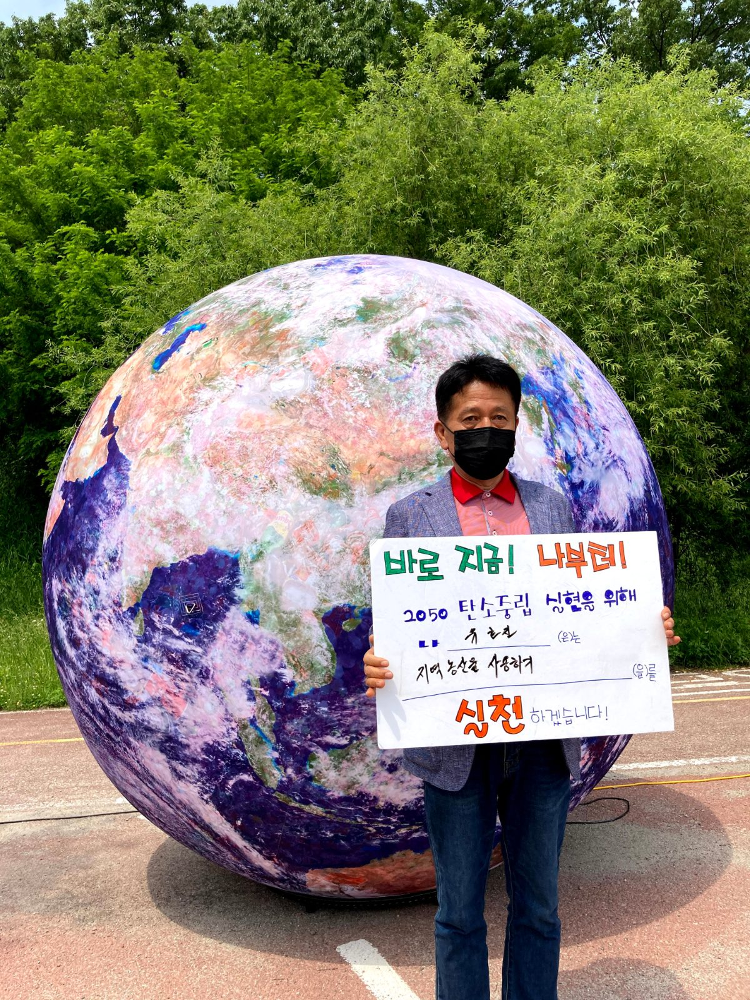
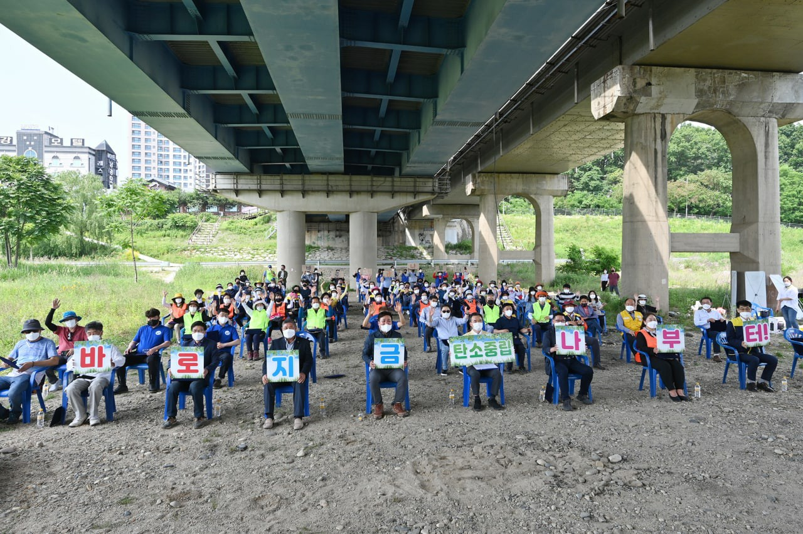
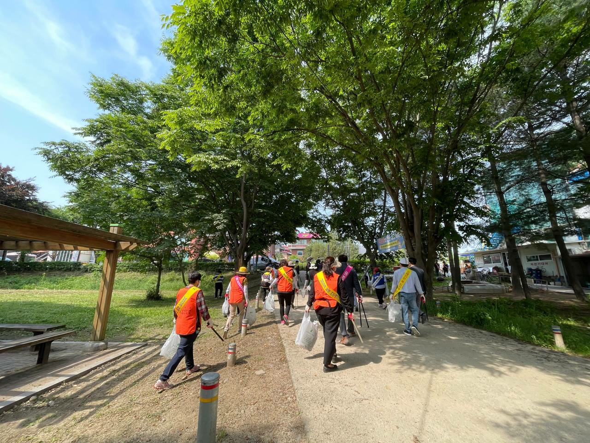
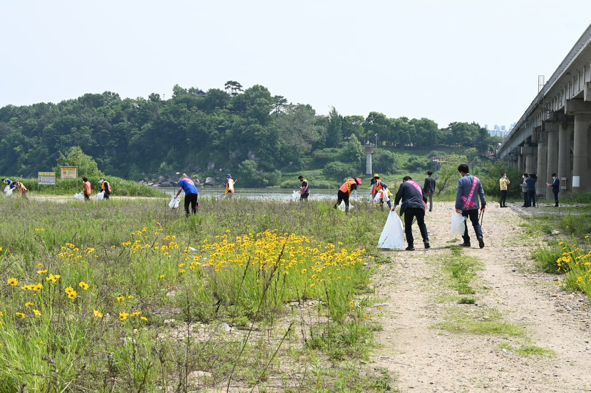
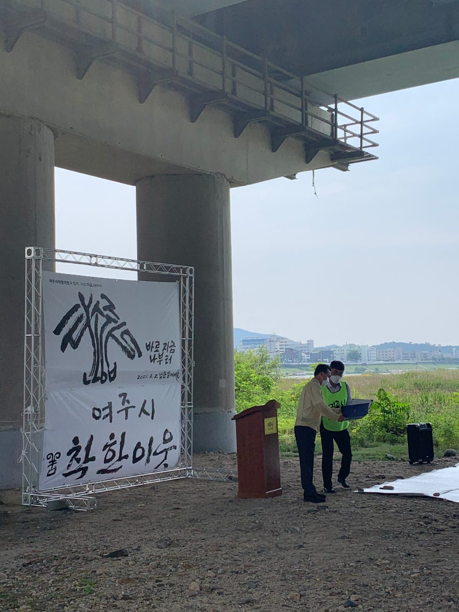
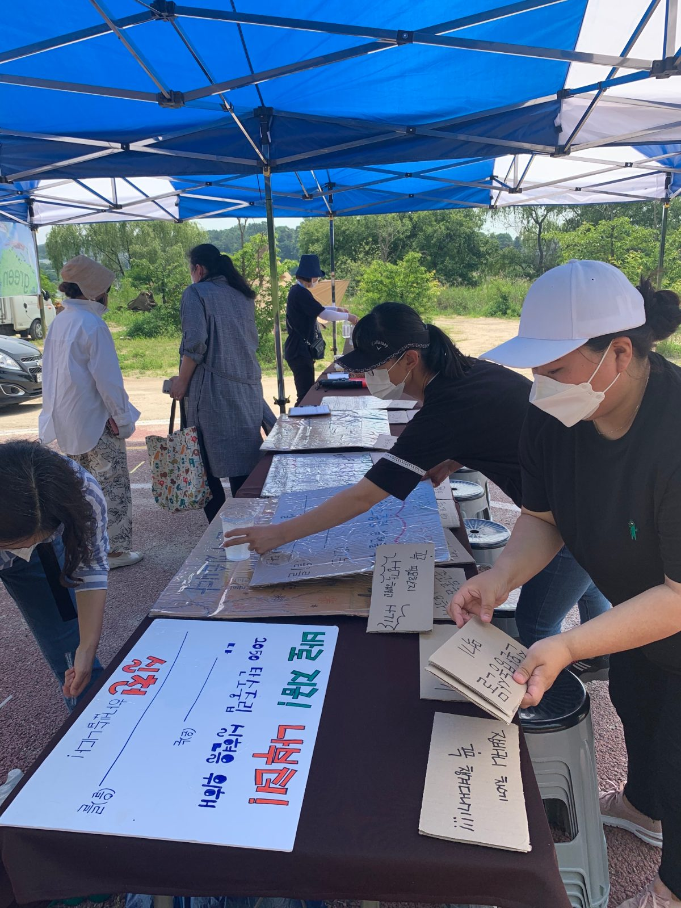
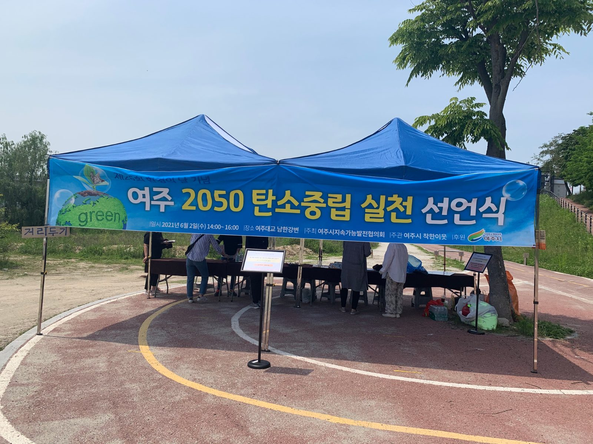

2021년 제 26회 환경의 날 기념 탄소중립 실천 선언식 및 2차 환경정화 활동을 실시 하였습니다.~ 
 
- 일시 : 2021년 6월 2일 (수) 오후 2시 ~ 4시 
- 장소 : 여주대교 밑 하천둔지 
- 주요내용 : 탄소중립 실천 선언식, 수변구역 정화활동 
- 주최 : 여주시지속가능발전협의회 
- 주관 : 여주시착한이웃 
 
여주시착한이웃의 많은 단체들이 함께합니다. 
 
한국자유총연맹여주시지회 / 한강지키기운동여주지역본부 / 특별대책지역수질보전정책협의회 / 여주친환경출하회 / 여주시친환경농업인연합회 / 여주지역자활센터 / 여주시지속가능발전협의회 / 여주시사회적공동체협의회 / 여주시사회복지협의회 / 여주문화원 / 여민협동조합 / 여강길 / 바르게살기운동여주시협의회 / 대한적십자봉사회 여주지구협의회 / 농산어촌교육협동조합 / 경기민예총 여주지부 / 경기도여성단체협의회 여주시지회 
 

