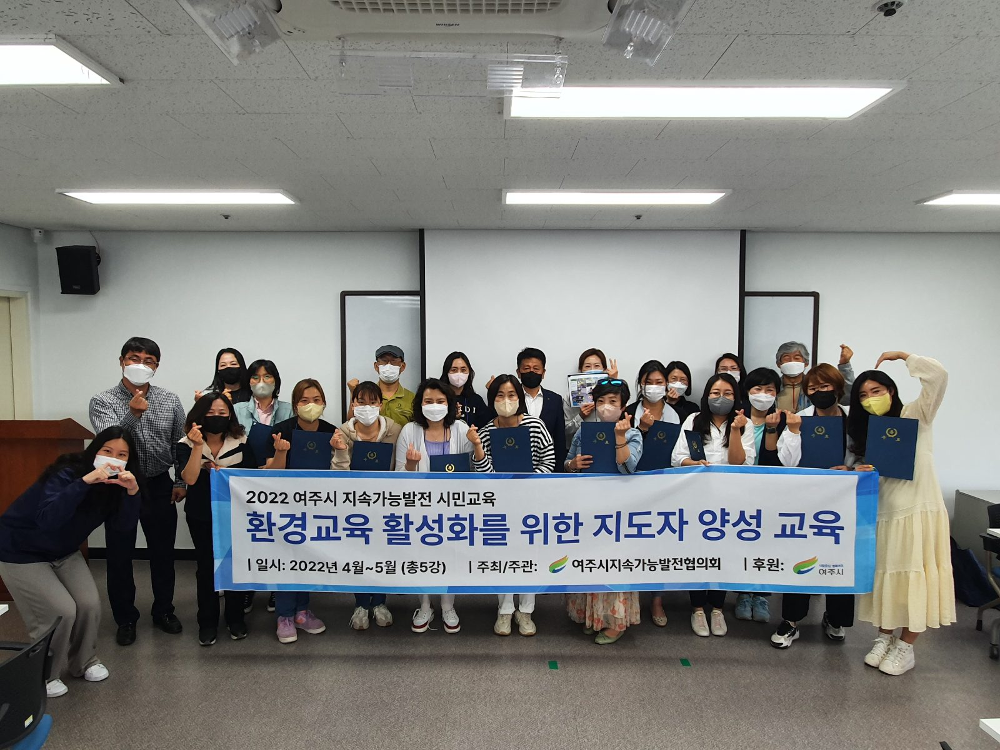
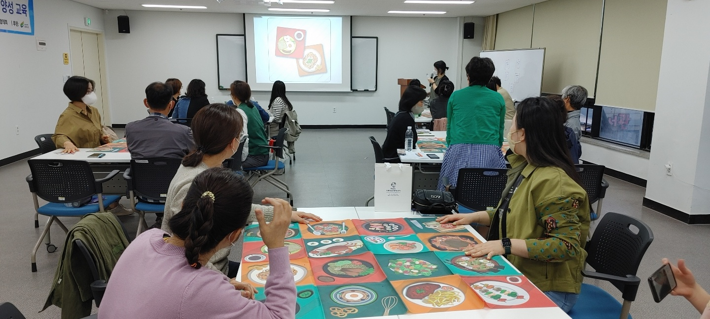
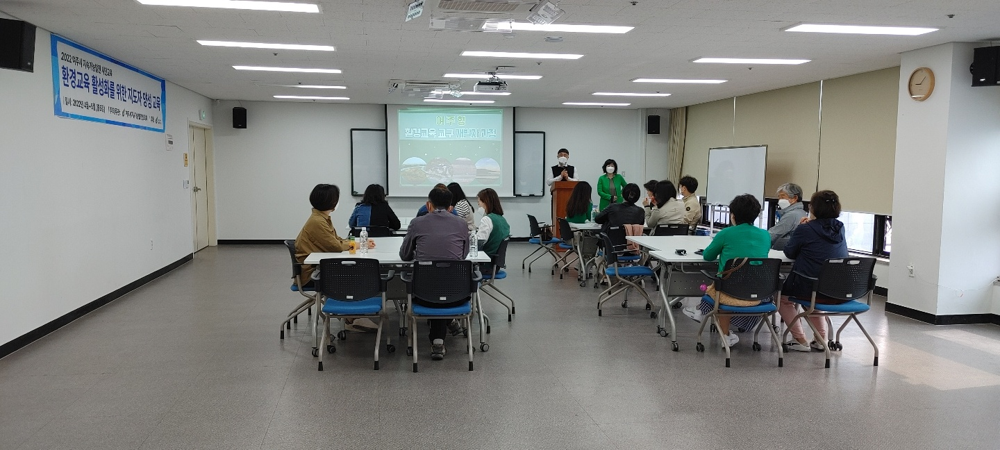

&lt;환경교육 지도자 양성과정 진행&gt;

개최일시: 2022년4월~5월 (총 5회, 1회당4시간)

배경:급격한 사회 변화와 함께 새로운 환경이슈가 발생하지만, 환경교육 현장에서는 발 빠르게 환경이슈를 다루는데 어려움이 있음.

교육의 패러다임이 교수자 중심에서 학습자중심으로 변화하고 있으며, 학습자의 주체적이고 창의적인 사고를 유발하고, 더불어 배우는 협동적 학습이 강화되고 있음.

이에 환경교육지도자들이 환경교육 현장에 필요한 교구를 직접 개발하여 학습자 중심의 참여 수업을 기획하고, 운영할 수 있도록 지원할 수 있는 역량강화 교육이 필요함.

주최/주관 : 여주시지속가능발전협의회

