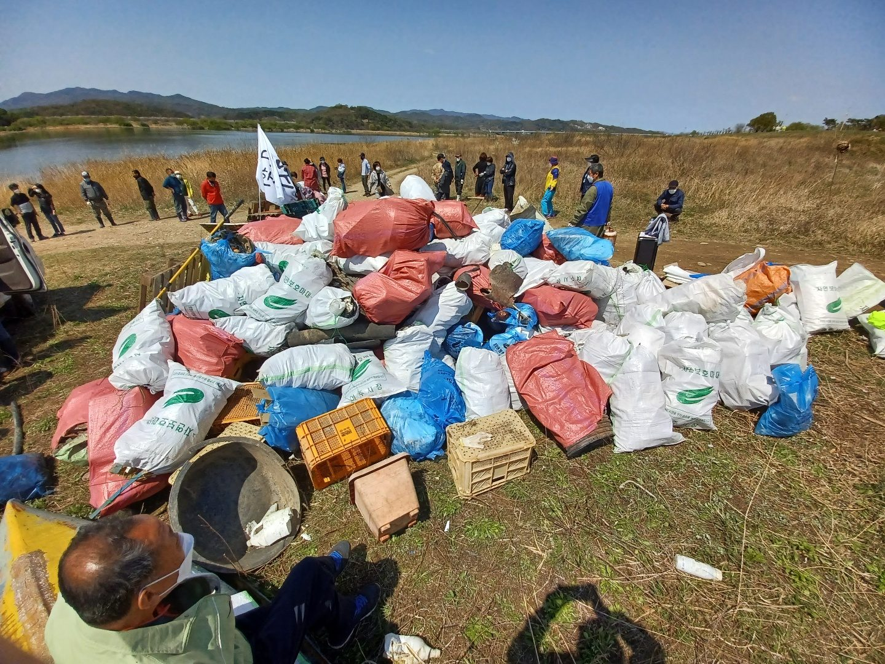
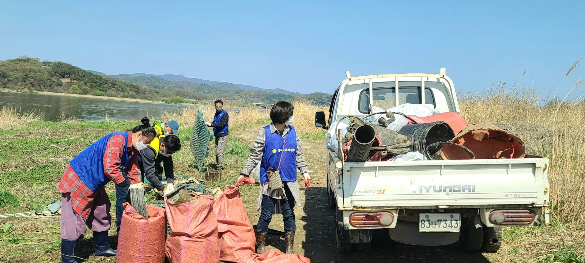
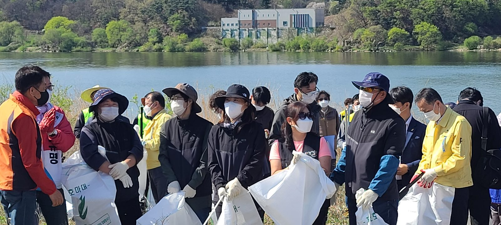
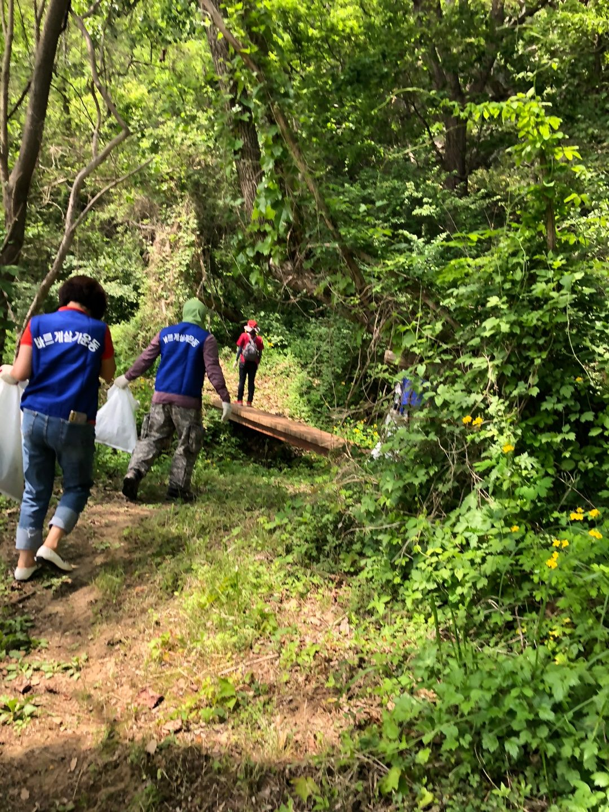
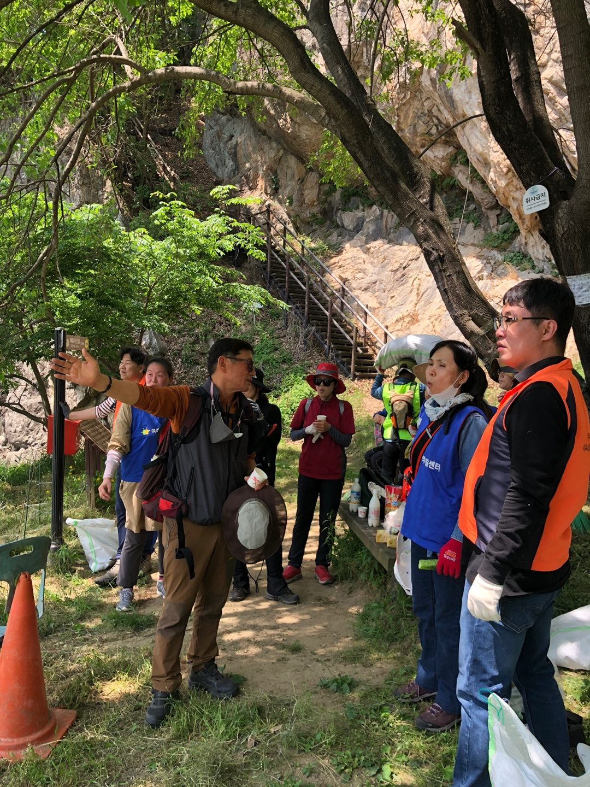
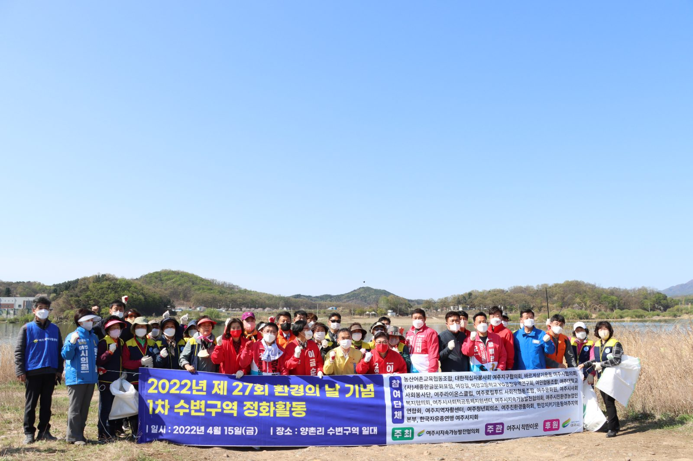

&lt;2022년 제27회 환경의 날 기념 수변구역 정화활동 실시&gt; 

○ 활동기간 : 정화활동 1차 - 2022년 4월 15일,

                              2차 - 2022년 5월 12일

○ 활동대상 : 정화활동 – 시민단체연합

○ 활동장소 : 1차 – 대신면 양촌리 수변구역 일대 (정화활동)

                  2차 – 강천면 자산 일대 (가시박제거)

