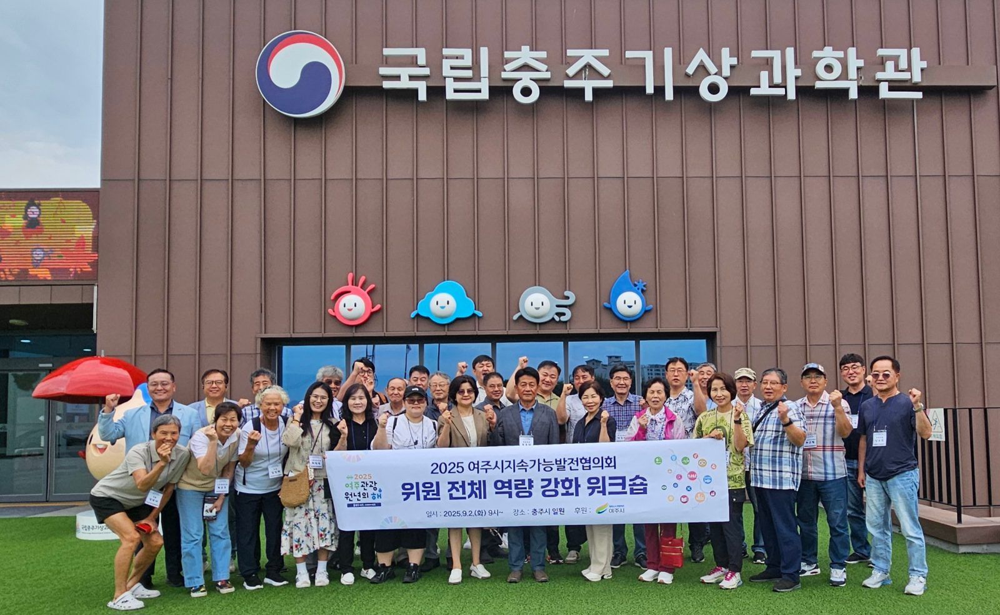
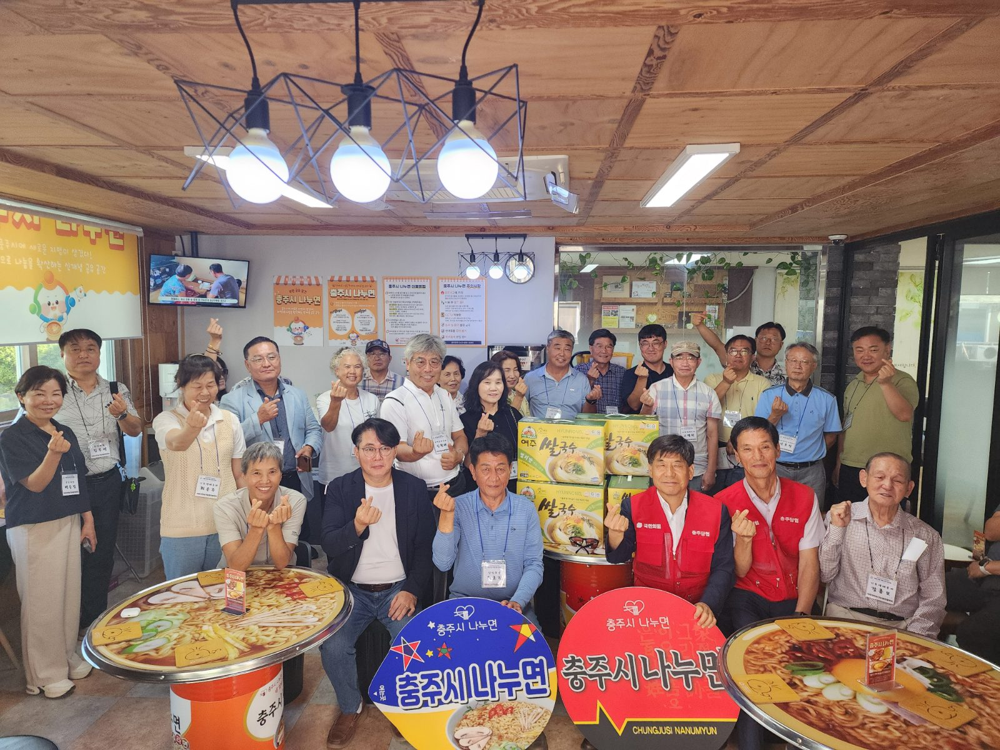
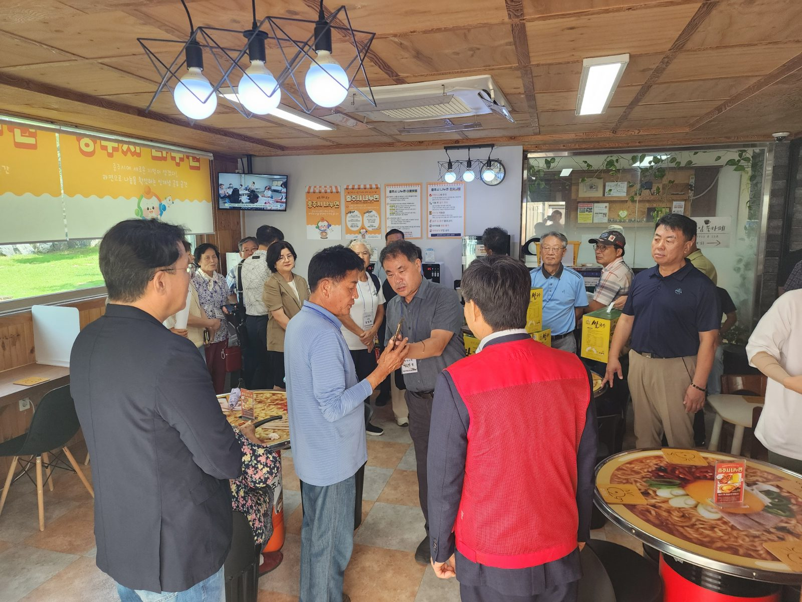
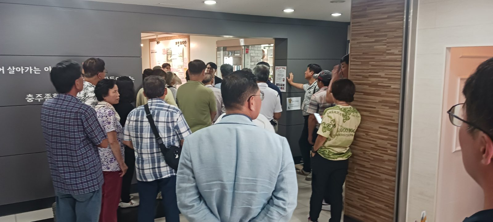
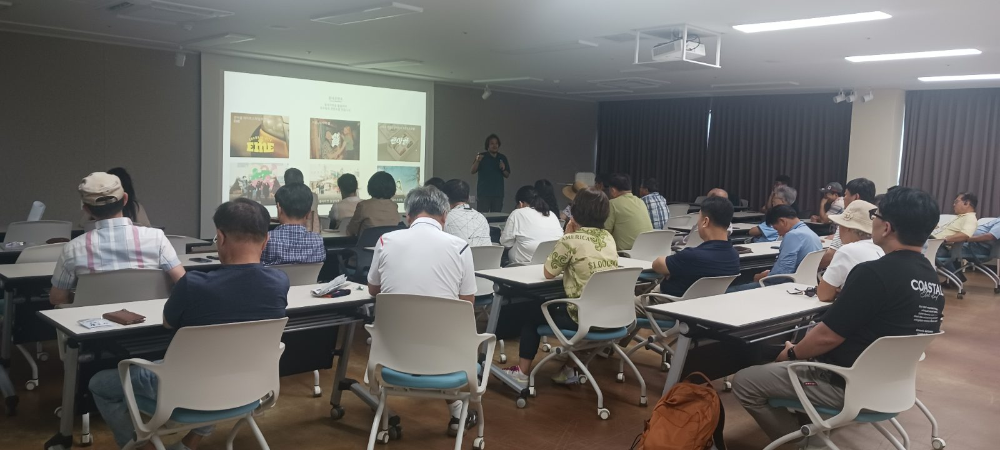

&lt;여주시지속협 위원 전체 역량 강화 워크숍 진행 완료&gt;

일시: 2025년 9월 2일(화) 9시-18시

장소: 충주시 일원(기상과학관, 나누면, 관아골 외)

대상: 지속협 위원 32명

가을의 계절로 접어드는 9월, 맑고 푸르며 청명한 날 여주시지속협 유호진 상임회장님외 공동회장님, 운영위원님, 분과위원님, 위원님들을 모시고 충주 일대로 워크숍을 다녀왔습니다.

충주국립기상과학관에서 기상 체험을 하고 점심으로 맛있는 송어회도 먹었습니다^^.

나누면과 관아골 도시재생 활성화 사례를 듣고 투어를 끝으로 하루 일정을 마무리하였습니다.

충주시의 도시재생 활성화 사례를 바탕으로 여주에서 적용할 수 있는 기후위기 대응, 청년 활동 활성화, 복지 및 공동체 회복 방안 등을 모색할 수 있는 좋은 기회가 되었던 시간이였습니다.

바쁘신데도 여주시의 지속가능한 발전을 위해 참여해주신 여주지속협 위원님들 함께해주셔서 너무너무 감사합니다.

https://sejongnewspaper.com/37905

<band:attachment>
<button>작게보기</button><button>삭제</button>

<button>삭제</button>   ≪세종신문≫ 여주시지속가능발전협의회, 12기 위원 역량 강화 워크숍 개최 충주사례를바탕으로지속가능한지역발전방안모색  여주시지속가능발전협의회(상임회장유호진)는지난2일충주일원에서워크숍을개최했다.이번워크숍 sejongnewspaper.com 

</band:attachment>
