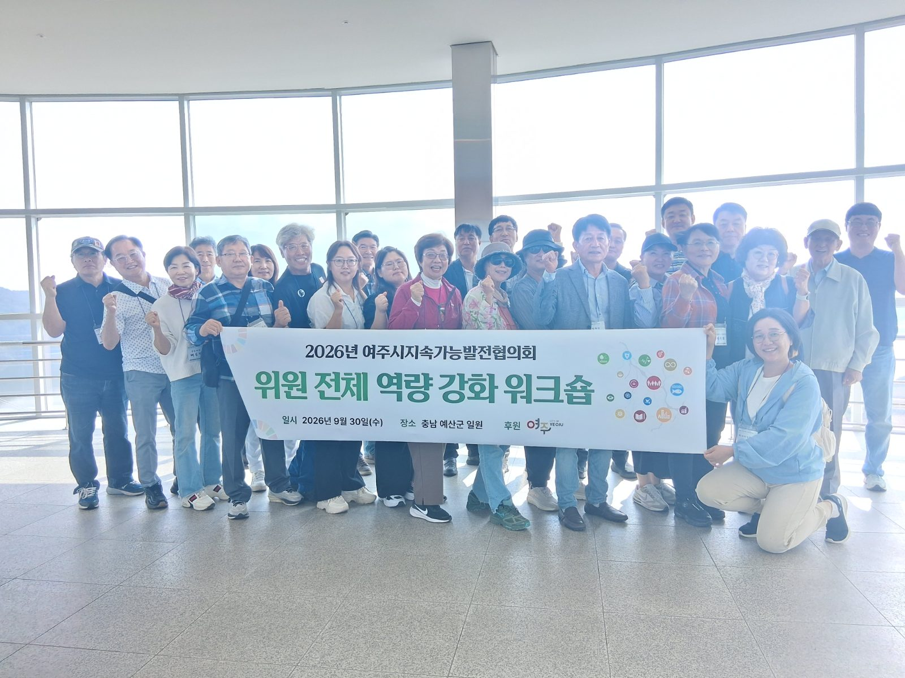
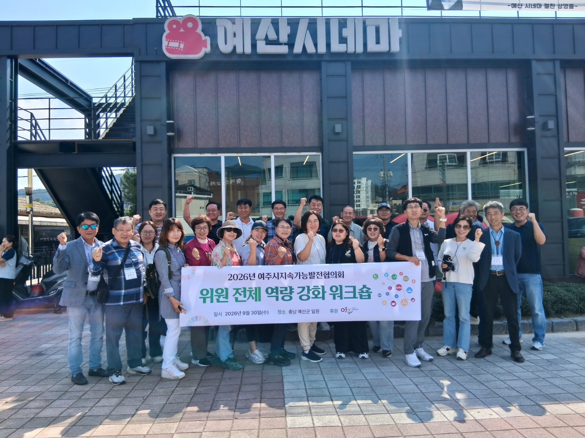
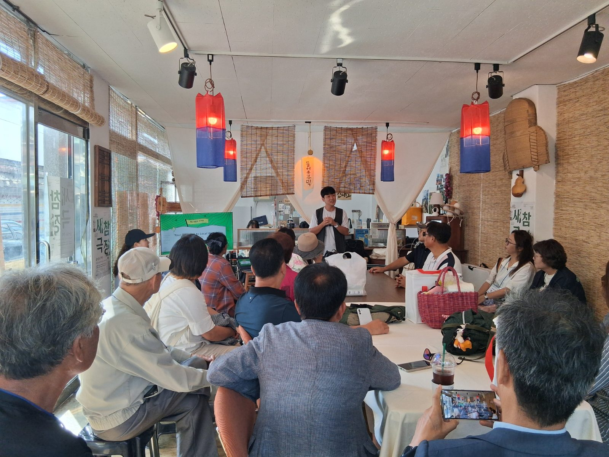
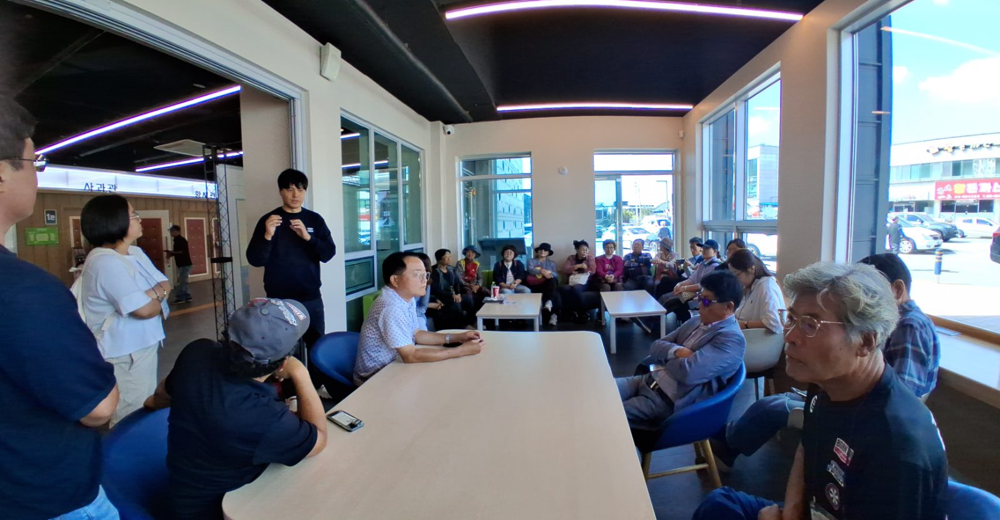
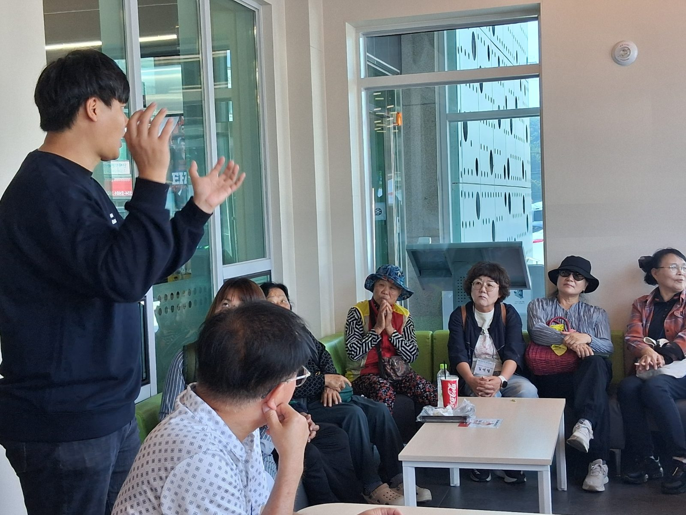

<b>여주시지속가능발전협의회 위원 전체 워크숍 진행 완료</b> 
일시: 9월 30일(수), 08:30~19:00 
여주시지속가능발전협의회 위원 전체 워크숍을 예산군에서 진행했습니다. 
이번 워크숍에서는 다양한 지역 사례를 직접 살펴보고, 위원님들과 함께 소통하며 지속가능한 지역발전의 방향을 생각해보는 뜻깊은 시간을 가졌습니다. 
 
*주요 일정 
예당호 출렁다리·전망대 견학 
예산시네마 지역문화 사례 청취 
예산상설시장 견학 
원도심 지역 사례 청취 
위원님들 함께 해주셔서 정말 감사합니다. 
 
이번 워크숍에서 보고, 듣고, 느낀 점을 여주의 지속가능한 발전과 연결해보는 「워크숍 후기 및 정책제안 공모전」도 진행합니다! 
 
*공모 주제 
① 워크숍 후기 
② 정책제안 (자유형식) 
 
시상--&gt;최우수상 1명, 우수상 1명 
위원님들의 생생한 워크숍 후기와 여주에 적용해보고 싶은 좋은 정책 아이디어를 자유롭게 담아주세요. 
함께 보고, 함께 배우고, 함께 제안하는 지속가능한 여주의 미래! 
접수: 2026년 10월 15일까지 
메일: 21yeoju@hanmail.net 
 
위원님들의 많은 관심과 참여 부탁드립니다. ^^ 
여주시지속가능발전협의회

