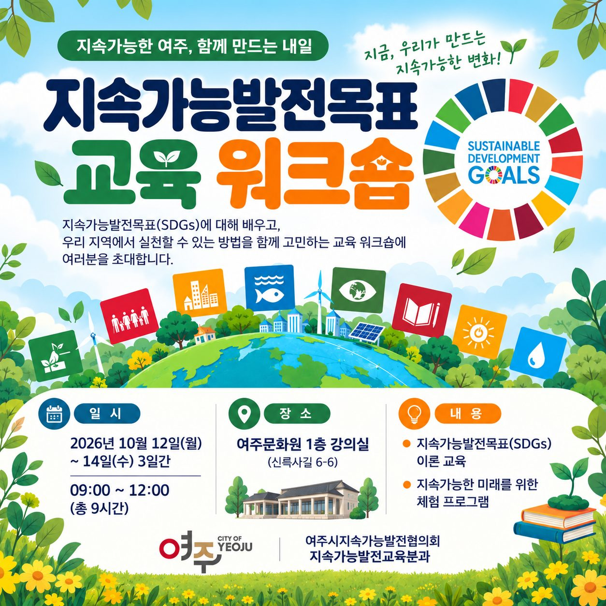

<strong>지속가능발전목표(SDGs) 교육 워크숍 안내</strong>

 
여주시지속가능발전협의회 지속가능발전교육분과에서 <strong>지속가능발전목표(SDGs) 교육 워크숍</strong>을 진행합니다.

<strong>일시 </strong>2026년 10월 12일(월) ~ 14일(수) / 3일간  ⏰ 09:00 ~ 12:00

<strong>장소 </strong>여주문화원 1층 강의실 (신륵사길 6-6)

<strong>주요 내용</strong> 
• 지속가능발전목표(SDGs) 이론 교육 
• 지속가능한 미래를 위한 체험 프로그램

<strong>여주시지속가능발전협의회 지속가능발전교육분과</strong>

